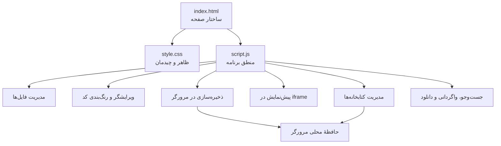

# ویرایشگر HTML، CSS و JavaScript

## نقشهٔ ساختار پروژه

### نقشهٔ فایل‌ها

| فایل | مسئولیت |
|---|---|
| `index.html` | ساختار صفحه، دکمه‌ها، پنل‌ها، پنجرهٔ دانلود و قاب پیش‌نمایش |
| `style.css` | رنگ‌ها، چیدمان، واکنش‌گرایی و ظاهر ویرایشگر |
| `script.js` | مدیریت فایل‌ها، ویرایش کد، رنگ‌بندی، جست‌وجو، ذخیره‌سازی، کتابخانه‌ها و دانلود |
| `README.md` | نقشهٔ پروژه، اولویت ایرادها، راه‌حل‌ها و روش اجرا |

## ایرادها، راه‌حل‌ها و اولویت‌بندی

اولویت‌ها بر اساس احتمال از دست رفتن اطلاعات، تأثیر بر عملکرد و سپس نگه‌داری‌پذیری تعیین شده‌اند.

| اولویت | ایراد یا ریسک | راه‌حل | وضعیت |
|---|---|---|---|
| **۱ ـ بحرانی برای داده‌ها** | در صورت شکست ذخیره‌سازی در حافظهٔ محلی، برنامه ممکن بود همچنان موفقیت را اعلام کند و نشانگر تغییرات ذخیره‌نشده را پاک کند. | نتیجهٔ ذخیره‌سازی بررسی می‌شود؛ در صورت شکست، هشدار نمایش داده می‌شود و وضعیت تغییرات ذخیره‌نشده باقی می‌ماند. | **برطرف شد** |
| **۱ ـ پایداری** | داده‌های قدیمی یا ناقص در حافظهٔ محلی بدون بررسی کافی پذیرفته می‌شدند و می‌توانستند باعث خطا هنگام بازکردن فایل شوند. | نوع فایل، متن محتوا، شناسه و نام فایل‌ها هنگام بازیابی بررسی و داده‌های نامعتبر کنار گذاشته می‌شوند. | **برطرف شد** |
| **۲ ـ پایداری** | ذخیره یا تغییر وضعیت کتابخانه‌ها ممکن بود در صورت پرشدن حافظه شکست بخورد، بدون اینکه عملیات به کاربر اعلام شود. | نتیجهٔ ذخیره بررسی می‌شود؛ در صورت شکست، تغییر ناموفق بازگردانده و پیام مناسب نمایش داده می‌شود. | **برطرف شد** |
| **۲ ـ دسترس‌پذیری** | لازم است رفتار صفحه‌کلید، فوکوس قابل مشاهده، برچسب‌های عناصر و سازگاری با صفحه‌خوان در مرورگرهای مختلف آزمایش شود. | اجرای آزمون‌های دستی صفحه‌کلید و صفحه‌خوان و اصلاح مواردی که در آزمون تأیید می‌شوند. | **نیازمند آزمون تکمیلی** |
| **۲ ـ نگه‌داری‌پذیری** | منطق برنامه در یک فایل JavaScript بزرگ قرار دارد و تغییرات آینده را دشوارتر می‌کند. | در مرحله‌ای جداگانه، کد به بخش‌های مستقل مانند ذخیره‌سازی، ویرایشگر، پیش‌نمایش و کتابخانه‌ها تقسیم شود؛ پس از هر مرحله آزمون انجام شود. | **پیشنهاد مرحلهٔ بعد** |
| **۳ ـ وابستگی شبکه** | دریافت خودکار کتابخانه‌ها به دسترسی شبکه و در دسترس بودن نشانی میزبان کتابخانه وابسته است. | پیام خطا و امکان افزودن دستی کد کتابخانه حفظ شود؛ برای کار کاملاً آفلاین، نسخهٔ محلی کتابخانه‌ها جداگانه فراهم شود. | **محدودیت شناخته‌شده** |
| **۳ ـ آزمون‌پذیری** | مخزن هنوز مجموعهٔ آزمون خودکار برای ذخیره‌سازی، مدیریت فایل، دانلود و پیش‌نمایش ندارد. | پس از تثبیت رفتار برنامه، آزمون‌های خودکار و چک‌لیست آزمون مرورگر اضافه شوند. | **پیشنهاد مرحلهٔ بعد** |

## تغییرات انجام‌شده در این بازبینی

- بررسی نتیجهٔ ذخیرهٔ پروژه و نمایش هشدار در صورت شکست.
- نگه‌داشتن وضعیت «تغییرات ذخیره‌نشده» تا زمانی که ذخیره واقعاً موفق شود.
- اعتبارسنجی داده‌های بازیابی‌شده از حافظهٔ محلی پیش از استفاده.
- بررسی موفقیت ذخیرهٔ کتابخانه‌ها و بازگرداندن تغییرات ناموفق.
- بازنویسی این راهنما به زبان فارسی و قراردادن نقشهٔ پروژه در ابتدای آن.

## روش اجرا

۱. مخزن را دانلود کنید یا فایل‌های آن را دریافت کنید.

۲. این سه فایل را کنار هم در یک پوشه نگه دارید:

- `index.html`
- `style.css`
- `script.js`

۳. فایل `index.html` را در یک مرورگر به‌روز باز کنید.

برای اجرای پایه، مرحلهٔ ساخت جداگانه لازم نیست. قابلیت دریافت کتابخانه‌ها از میزبان‌های بیرونی به اتصال اینترنت وابسته است.

## میانبرهای صفحه‌کلید

| میانبر | عملکرد |
|---|---|
| `Ctrl/Cmd + S` | ذخیرهٔ پروژه |
| `Ctrl/Cmd + Shift + S` | بازکردن پنجرهٔ دانلود |
| `Ctrl/Cmd + F` | رفتن به جست‌وجوی کد |
| `Ctrl/Cmd + Z` | واگردانی |
| `Ctrl/Cmd + Y` یا `Ctrl/Cmd + Shift + Z` | انجام دوباره |

## محدودهٔ بررسی

این بازبینی شامل بررسی ایستای فایل‌های اصلی و اصلاح ایرادهای مشخص‌شده در ذخیره‌سازی و بازیابی داده‌هاست. اجرای کامل در مرورگرها، آزمون دسترس‌پذیری و آزمون خودکار هنوز انجام نشده‌اند؛ بنابراین وضعیت آن‌ها به‌عنوان آزمون تکمیلی ثبت شده است.
