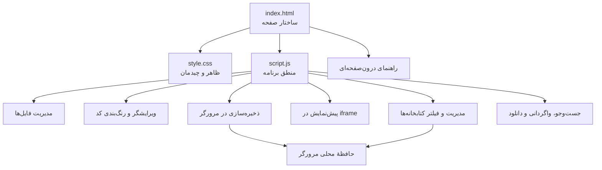

# ویرایشگر HTML، CSS و JavaScript

## نقشهٔ ساختار پروژه

### نقشهٔ فایل‌ها

| فایل | مسئولیت |
|---|---|
| `index.html` | ساختار صفحه، دکمه‌ها، پنل‌ها، راهنمای درون‌صفحه‌ای، پنجرهٔ دانلود و قاب پیش‌نمایش |
| `style.css` | رنگ‌ها، چیدمان، واکنش‌گرایی و ظاهر ویرایشگر |
| `script.js` | مدیریت فایل‌ها، ویرایش کد، رنگ‌بندی، تکمیل خودکار، جست‌وجو، ذخیره‌سازی، فهرست و فیلتر کتابخانه‌ها و دانلود |
| `intellisense-data.js` | بانک اطلاعات محلی تکمیل خودکار برای تگ‌ها و ویژگی‌های HTML، ویژگی‌های CSS و پیشنهادهای JavaScript |
| `README.md` | نقشهٔ پروژه، اولویت ایرادها، راه‌حل‌ها و روش اجرا |

## ایرادها، راه‌حل‌ها و اولویت‌بندی

اولویت‌ها بر اساس احتمال از دست رفتن اطلاعات، تأثیر بر عملکرد و سپس نگه‌داری‌پذیری تعیین شده‌اند.

| اولویت | ایراد یا ریسک | راه‌حل | وضعیت |
|---|---|---|---|
| **۱ ـ بحرانی برای داده‌ها** | در صورت شکست ذخیره‌سازی در حافظهٔ محلی، برنامه ممکن بود همچنان موفقیت را اعلام کند و نشانگر تغییرات ذخیره‌نشده را پاک کند. | نتیجهٔ ذخیره‌سازی بررسی می‌شود؛ در صورت شکست، هشدار نمایش داده می‌شود و وضعیت تغییرات ذخیره‌نشده باقی می‌ماند. | **برطرف شد** |
| **۱ ـ پایداری** | داده‌های قدیمی یا ناقص در حافظهٔ محلی بدون بررسی کافی پذیرفته می‌شدند و می‌توانستند باعث خطا هنگام بازکردن فایل شوند. | نوع فایل، متن محتوا، شناسه و نام فایل‌ها هنگام بازیابی بررسی و داده‌های نامعتبر کنار گذاشته می‌شوند. | **برطرف شد** |
| **۲ ـ پایداری** | ذخیره یا تغییر وضعیت کتابخانه‌ها ممکن بود در صورت پرشدن حافظه شکست بخورد، بدون اینکه عملیات به کاربر اعلام شود. | نتیجهٔ ذخیره بررسی می‌شود؛ در صورت شکست، تغییر ناموفق بازگردانده و پیام مناسب نمایش داده می‌شود. | **برطرف شد** |
| **۲ ـ دسترس‌پذیری** | نشانگر فوکوس برای بعضی کنترل‌ها مشخص نبود و پیوند معنایی زبانه‌ها به پنل‌های مربوط کامل نبود. | نشانگر فوکوس قابل مشاهده افزوده شد و زبانه‌ها به پنل‌های ویرایشگر متصل شدند؛ آزمون صفحه‌کلید و صفحه‌خوان همچنان لازم است. | **بهبود اولیه انجام شد؛ آزمون تکمیلی لازم است** |
| **۲ ـ نگه‌داری‌پذیری** | منطق برنامه در یک فایل JavaScript بزرگ قرار دارد و تغییرات آینده را دشوارتر می‌کند. | در مرحله‌ای جداگانه، کد به بخش‌های مستقل مانند ذخیره‌سازی، ویرایشگر، پیش‌نمایش و کتابخانه‌ها تقسیم شود؛ پس از هر مرحله آزمون انجام شود. | **پیشنهاد مرحلهٔ بعد** |
| **۳ ـ وابستگی شبکه** | دریافت خودکار کتابخانه‌ها به دسترسی شبکه و در دسترس بودن نشانی میزبان کتابخانه وابسته است. | پیام خطا و امکان افزودن دستی کد کتابخانه حفظ شود؛ برای کار کاملاً آفلاین، نسخهٔ محلی کتابخانه‌ها جداگانه فراهم شود. | **محدودیت شناخته‌شده** |
| **۲ ـ تکمیل خودکار** | فهرست‌های اولیه محدود بودند و ویژگی‌های HTML، مقادیر CSS و اعضای شیءهای JavaScript را به‌صورت زمینه‌مند پوشش نمی‌دادند. | بانک محلی گسترده‌تر، پیشنهاد ویژگی‌های HTML بر اساس تگ، مقادیر CSS بر اساس ویژگی و اعضای شناخته‌شدهٔ JavaScript اضافه شد. | **بهبود شد؛ پوشش کامل استاندارد و آزمون مرورگر همچنان لازم است** |\n| **۳ ـ آزمون‌پذیری** | مخزن هنوز مجموعهٔ آزمون خودکار برای ذخیره‌سازی، مدیریت فایل، دانلود و پیش‌نمایش ندارد. | پس از تثبیت رفتار برنامه، آزمون‌های خودکار و چک‌لیست آزمون مرورگر اضافه شوند. | **پیشنهاد مرحلهٔ بعد** |

## تغییرات انجام‌شده در این بازبینی

- بررسی نتیجهٔ ذخیرهٔ پروژه و نمایش هشدار در صورت شکست.
- نگه‌داشتن وضعیت «تغییرات ذخیره‌نشده» تا زمانی که ذخیره واقعاً موفق شود.
- اعتبارسنجی داده‌های بازیابی‌شده از حافظهٔ محلی پیش از استفاده.
- بهبود نشانگر فوکوس صفحه‌کلید و ارتباط معنایی زبانه‌ها با پنل‌های مربوط.
- بررسی موفقیت ذخیرهٔ کتابخانه‌ها و بازگرداندن تغییرات ناموفق.
- بازنویسی این راهنما به زبان فارسی و قراردادن نقشهٔ پروژه در ابتدای آن.
- افزودن راهنمای جامع درون‌صفحه‌ای و کاتالوگ کتابخانه‌های قابل جست‌وجو با فیلتر CSS/JavaScript.

## مبنای بانک اطلاعات تکمیل خودکار

این بانک به‌صورت محلی نگه‌داری می‌شود تا برای پیشنهادهای اصلی به CDN وابسته نباشد. ساختار آن از مراجع عمومی و استانداردهای وب الهام گرفته شده است؛ داده‌های اختصاصی یا کد داخلی ویرایشگرهای تجاری کپی نشده‌اند.

- [مرجع عناصر و ویژگی‌های HTML در MDN](https://developer.mozilla.org/en-US/docs/Web/HTML/Reference)
- [مرجع ویژگی‌های عمومی HTML در MDN](https://developer.mozilla.org/en-US/docs/Web/HTML/Reference/Global_attributes)
- [مرجع ویژگی‌های CSS در MDN](https://developer.mozilla.org/en-US/docs/Web/CSS/Reference/Properties)
- [مرجع JavaScript در MDN](https://developer.mozilla.org/en-US/docs/Web/JavaScript/Reference)

این نسخه یک پایگاه اولیهٔ گسترده و قابل گسترش است، نه تضمین پوشش تمام APIها، مقادیر جدید CSS یا همهٔ کتابخانه‌های شخص ثالث. برای پیشنهادهای دقیق‌تر در آینده می‌توان داده‌ها را از منابع باز و نسخه‌دار به‌روزرسانی کرد.

## راهنمای درون‌صفحه‌ای و تکمیل تب کتابخانه‌ها

- تب **Help** در خود ویرایشگر راهنمای مرحله‌به‌مرحلهٔ کار با محیط، نوشتن HTML/CSS/JavaScript، تکمیل خودکار، ذخیره، دانلود، میانبرها و رفع اشکال را نشان می‌دهد.
- در راهنمای درون‌صفحه‌ای، دکمه‌های شروع سریع امکان رفتن مستقیم به تب HTML، CSS، JS یا Libraries را می‌دهند.
- کاتالوگ کتابخانه‌ها اکنون **۸۵ گزینهٔ آماده** دارد؛ از چارچوب‌های CSS و آیکون‌ها تا نمودارها، تاریخ، فایل‌های Excel/CSV، PDF/Word، نقشه، هایلایت کد و ابزارهای کمکی.
- جست‌وجوی کاتالوگ بر اساس نام یا کاربرد و فیلتر نوع CSS/JavaScript اضافه شده است.
- انتخاب گزینه تلاش می‌کند فایل مرورگری کتابخانه را از CDN دریافت کند. اگر میزبان به درخواست مرورگر اجازه ندهد، باید فایل مناسب را از مستندات رسمی دریافت و کد آن را دستی وارد کرد.
- انتخاب از کاتالوگ به‌تنهایی کتابخانه را فعال نمی‌کند: ابتدا کد را به **Saved Libraries** اضافه کنید و سپس چک‌باکس آن را فعال نگه دارید.
- همهٔ کتابخانه‌ها در قالب یک فایل قابل استفاده نیستند؛ بعضی به وابستگی یا پیکربندی نیاز دارند. نسخه، مجوز استفاده و دستورالعمل رسمی هر کتابخانه را بررسی کنید. دریافت موفق کد به‌تنهایی تضمین‌کنندهٔ عملکرد آن نیست.

## روش اجرا

۱. مخزن را دانلود کنید یا فایل‌های آن را دریافت کنید.

۲. این سه فایل را کنار هم در یک پوشه نگه دارید:

- `index.html`
- `style.css`
- `script.js`

۳. فایل `index.html` را در یک مرورگر به‌روز باز کنید.

برای اجرای پایه، مرحلهٔ ساخت جداگانه لازم نیست. قابلیت دریافت کتابخانه‌ها از میزبان‌های بیرونی به اتصال اینترنت وابسته است.

## میانبرهای صفحه‌کلید

| میانبر | عملکرد |
|---|---|
| `Ctrl/Cmd + S` | ذخیرهٔ پروژه |
| `Ctrl/Cmd + Shift + S` | بازکردن پنجرهٔ دانلود |
| `Ctrl/Cmd + F` | رفتن به جست‌وجوی کد |
| `Ctrl/Cmd + Z` | واگردانی |
| `Ctrl/Cmd + Y` یا `Ctrl/Cmd + Shift + Z` | انجام دوباره |

## محدودهٔ بررسی

این بازبینی شامل بررسی ایستای فایل‌های اصلی و اصلاح ایرادهای مشخص‌شده در ذخیره‌سازی و بازیابی داده‌هاست. اجرای کامل در مرورگرها، آزمون دسترس‌پذیری و آزمون خودکار هنوز انجام نشده‌اند؛ بنابراین وضعیت آن‌ها به‌عنوان آزمون تکمیلی ثبت شده است.
